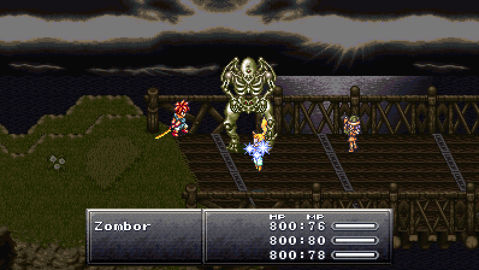
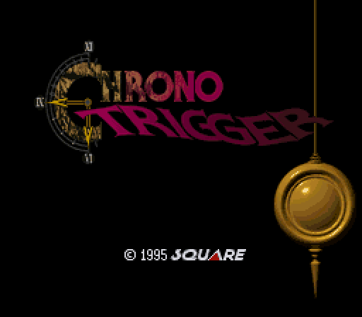
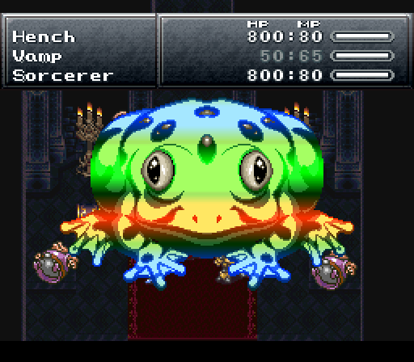
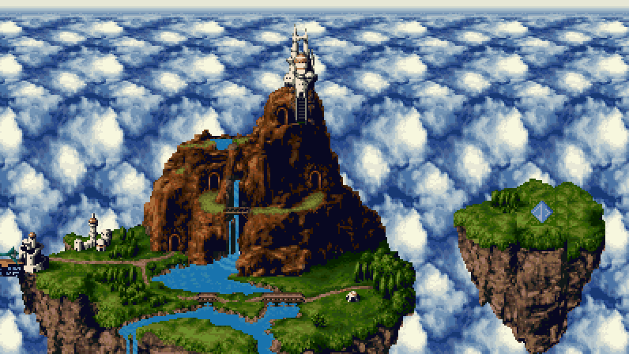
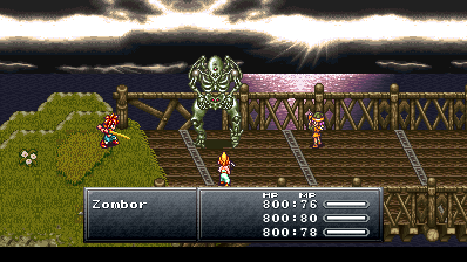
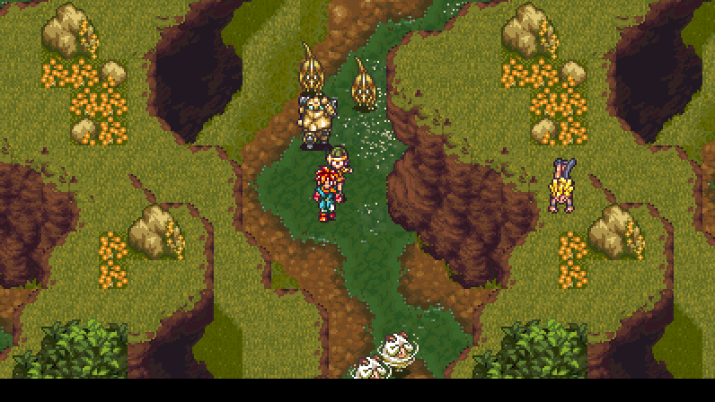
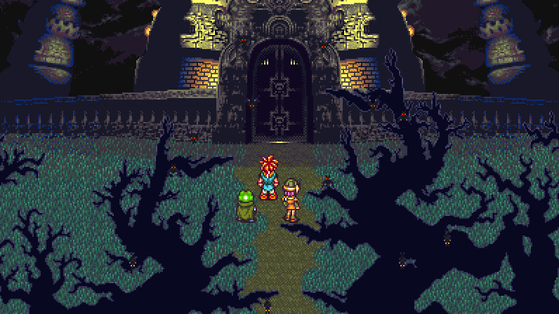
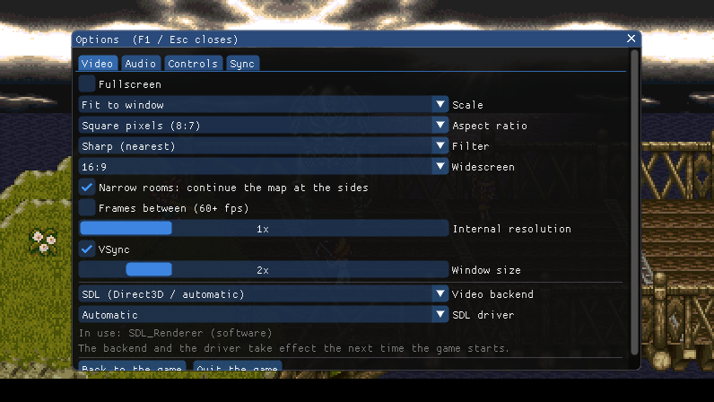

# BelthasarProject

[](https://github.com/TemplarServant/BelthasarProject/actions/workflows/ci.yml)

A native C re-implementation of **Chrono Trigger** (SNES, USA, 1995), checked frame by frame against the original
program running in an embedded SNES core.

<p align="center">
  
  <br><sub>The C engine running a battle from the attract demo, widescreen mod on (<a href="docs/media/widescreen-battle.mp4">MP4</a>).</sub>
</p>

BelthasarProject is named after Belthasar, the Guru of Reason who designed the Epoch. The name keeps clear of the "Chrono"
trademark.

> **Legal notice.** This repository contains **no part of the game**: no program code, graphics, music, text or
> data from the cartridge. To use it you need your own dump of **Chrono Trigger (USA)**, made from your cartridge
> with a cartridge reader -- how: [docs/ROM.md](docs/ROM.md#dumping-your-cartridge), following the preservation
> community's guide <https://dumping.guide/carts/nintendo/snes>. The engine, the oracle and the setup flow check the
> dump before they use it:
>
> | | |
> |---|---|
> | Size | 4,194,304 bytes (4 MiB), headerless. A 512-byte copier header is accepted and stripped. |
> | SHA-1 | `de5822f4f2f7a55acb8926d4c0eaa63d5d989312` (the No-Intro dump) |
> | CRC32 | `2D206BF7` |
>
> Everything derived from the ROM (the asset container, generated tables, translated stages, test states) is
> produced on your machine from your dump and is never distributed. See [docs/ROM.md](docs/ROM.md).
>
> Chrono Trigger is © Square Enix (originally Square Co., Ltd.). BelthasarProject is not affiliated with or endorsed by
> Square Enix or Nintendo.

## What it is

BelthasarProject is not a byte-matching disassembly and not an emulator. It is a portable C engine that behaves like the
game: the field, the event scripts, battles, menus, the overworld and the sound, all re-implemented routine by
routine from the 65816 code. The method is the one [snesrev/zelda3](https://github.com/snesrev/zelda3) proved:

- The original ROM, run in an embedded SNES core (the **oracle**, built on
  [LakeSnes](https://github.com/elzo-d/LakeSnes)), is the only source of truth.
- Every behaviour is derived from the ROM's disassembly and the oracle's RAM. Nothing is guessed, tuned by eye, or
  special-cased per scene.
- A routine counts as ported when the oracle and the C code agree, and a regression check pins that agreement.

The rules behind this, and the decisions that shaped them, are in [docs/METHODOLOGY.md](docs/METHODOLOGY.md) and
[docs/DECISIONS.md](docs/DECISIONS.md).

## Screenshots

Every picture is the C engine's own output during the attract demo (not the emulator), made by
[`tools/release/make_media.py`](tools/release/make_media.py).

| | |
|---|---|
|  |  |
| The title sequence | A battle tech, vanilla 256x224 |

With the widescreen mod (16:9), the field, the overworld and battles show more of the map at the sides:

| | |
|---|---|
|  |  |
|  |  |

The mods are switched on in the F1 overlay. With every option at its default, the game is the vanilla game:

<p align="center"></p>

## Status

The game boots like the cartridge does: the title sequence, the attract demo, the load screen, and a new game into
Crono's bedroom. From there the field, battles, menus, shops, the overworld and the music run on the C engine. The
project's owner plays it, reports what looks wrong, and each report is traced back to the ROM before it is fixed.
It is **not yet verified playable from start to finish**.

| Area | State | Notes |
|---|---|---|
| Field | Works | Event-script VM and scheduler, collision, movers, sprite priority and draw list, camera, textbox, doors and location changes, chests, naming screen, minigames met so far (the fair, the tent of horrors), iris and window wipes, the staff roll's caption plane. The field VM covers 217 opcodes, 99.9% of all script sites. The remaining sites are two ops that reset the stack (the engine runs them as the reboot they are, but no sweep can grade them) and the ROM's own panic stub. |
| Battle | Works | ATB, the menu pass, physical attacks, techs (single, dual, triple), items, status effects, enemy AI from the ROM's condition tables, counters, death dissolve, rewards, level-up, running away. Enemy census: 253 of 255 enemy fights identical to the cartridge under the timing rule. |
| Menus | Works | All six X-menu screens (Item, Equip, Tech, Config, Save, Form), shops, the load screen. Saving writes the 8 KB battery image to `ct_sram.srm`. |
| Overworld | Works | Camera and tilemap streaming, the ambient-object VM (birds, boats), the ferry, party followers, zoned music. |
| Sound | Works | The bank `$C7` driver upload, the song loader, the command channel, and the sound processor's program itself as C (`src/sound/`), sample-exact against the vendored SPC700/DSP it replaced. |
| Title and attract | Works | The title sequence is the overlay's own machine; the attract demo is audited against the cartridge frame by frame. |
| Mods (F1) | Works | Widescreen, internal resolution, frames between (60+ fps), free sync. Opt-in; with every option at its default the game is the vanilla game. |

### Not done

- **No check needs a private state any more** (since 2026-10-23). Everything the build needs is made from your ROM, and
  all 945 regression checks run in a fresh clone from your ROM, the recipes and the public battery saves. See
  [docs/ROADMAP.md](docs/ROADMAP.md#1-the-public-release-and-what-it-left-open).
- **The vendored core stays as the reference.** `Belthasar` runs no emulated hardware: the sound driver, the `$C3`
  sequence stages, the gate warp, the window wipe, the overworld window and the HDMA table builder are native C. The
  vendored LakeSnes core remains the oracle, the sound's reference (`CT_AUDIO_SPC=ref`) and the in-game lockstep
  (`CT_FIELDLOCK`); the translated programs in `src/xlat/` are `ct.exe`'s references only (`--xlatcmp`).
- **Open divergences.** A list of known differences from the cartridge (a few frames of timing in some battle
  exits and location loads, a handful of pictures) is kept in [docs/ROADMAP.md](docs/ROADMAP.md#2-engine).
- **The playthrough is graded only partway.** `tools/playthrough.py` grades one route against the cartridge leg by
  leg, from New Game to the prison after the trial (leg 32); the rest of the game is not on it yet.

## Quick start

For experimental macOS support, see the [local app build guide](docs/MACOS.md).

### Requirements

- **macOS (experimental):** Xcode Command Line Tools, Python 3, CMake, Ninja,
  pkg-config and SDL2; see the [Mac guide](docs/MACOS.md).
- **Windows:** Visual Studio 2022 Build Tools (MSVC, with the bundled CMake and Ninja) and Python 3.
- **Linux:** gcc or clang, CMake, `libsdl2-dev`, Python 3. The Linux build is a compile-parity build, not the
  reference platform (see [docs/INFRA.md](docs/INFRA.md#build)).
- **Android (experimental):** the Android SDK and NDK, built from Windows with Gradle, with on-screen touch controls;
  see the [Android guide](docs/ANDROID.md).
- Your own ROM, as described above.
- On Windows, clone into a short path (for example `C:\src\BelthasarProject`): the build's object paths under a
  long directory exceed Windows' 260-character limit and the compiler check fails.

### 1. Fetch the libraries (not in the repository)

```bat
powershell -ExecutionPolicy Bypass -File tools\get_sdl2.ps1            :: SDL2 -> third_party\SDL2
powershell -ExecutionPolicy Bypass -File tools\get_imgui.ps1           :: Dear ImGui -> third_party\imgui (the F1 overlay)
powershell -ExecutionPolicy Bypass -File tools\get_vulkan_headers.ps1  :: Vulkan headers -> third_party\vulkan (optional backend)
```

Without SDL2 only the headless oracle harness `ct.exe` is built. Without ImGui `Belthasar` builds with no overlay.
Without the Vulkan headers the Vulkan backend is left out. On Linux and macOS, use the system SDL2 and fetch ImGui
with `python3 tools/get_imgui.py`.

### 2. Set up from your ROM

```bat
python tools/setup.py --rom path\to\Chrono_Trigger_USA.sfc
```

The setup flow (about 15-20 minutes the first time; later runs reuse what did not change):

1. verifies the ROM (size and SHA-1) and copies it to `Chrono_Trigger_USA_SNES.sfc` at the root;
2. builds a bootstrap oracle (`build/ct.exe`) from the *shapes* of the generated files (`tools/gen/shapes/`:
   declarations and sizes, no data);
3. replays the recipes (`tools/recipes/`): the oracle runs your ROM from power-on to every game moment the
   generators need;
4. generates the asset captures, extracts `ct_assets.dat` (`assets/extract_assets.py`), then generates
   `src/data/*.h` and `src/xlat/*.c` (`tools/gen/manifest*.json`);
5. packs the generated tables into `ct_tables.dat` (`tools/gen/pack_tables.py`; a player's setup writes them inside
   the `ct_assets.dat` of their data folder instead);
6. builds everything.

`python tools/setup.py --check` regenerates every generated file and compares it with what is in place.

The regression suite's state fixtures are made the same way: `python tools/fetch_saves.py` first (the public battery
saves several recipes start from, downloaded from their sources and verified by SHA-256: tools/third_party_saves.json),
then `python tools/fixtures.py make all` (see [docs/TESTING_OVERVIEW.md](docs/TESTING_OVERVIEW.md)). No state file the
suite reads may exist on one machine only: `python tools/input_provenance.py` says where each one comes from.

### 3. Build

```bat
tools\build.bat              :: or: python tools/build.py [target]
```

`tools\build.bat` calls `tools/build.py`, which checks that each target's executable was actually relinked and
refuses to build while a `build\ct*.exe` is running (a running `Belthasar.exe` locks the file). Close the game before
you rebuild.

### 4. Run

After the setup, `ct_assets.dat` at the root is all the game reads; the ROM (`Chrono_Trigger_USA_SNES.sfc` at the
root, or `CT_ROM=<path>`) is the input of the setup and of `ct.exe`:

```bat
build\Belthasar.exe --assets ct_assets.dat --boot       :: the cartridge's cold start: title, then load screen or new game
build\Belthasar.exe --assets ct_assets.dat --newgame    :: straight into a new game (naming, then the 1000 A.D. pan)
build\Belthasar.exe --assets ct_assets.dat --scene 5    :: drop into one field scene
build\ct_viewer.exe --datonly ct_assets.dat            :: scene browser (Left/Right scene, Space pause, F full map)
```

With a ROM-free `ct_assets.dat` (what the setup makes) the game reads nothing from the ROM: the field, battles,
menus, the overworld and the sound all come from the container ([docs/ROM.md](docs/ROM.md#the-rom-free-runtime)).
The battery save lives in `ct_sram.srm` (`CT_SRAM` sets another path; `CT_SRAM_FRESH=1` boots an erased cart).

### Controls

The keyboard is one SNES pad. A controller works too, mapped by position.

| SNES | Key | | SNES | Key |
|---|---|---|---|---|
| D-pad | Arrow keys | | L | D |
| A (talk, confirm) | Z | | R | C |
| B (cancel; hold to run) | X | | Start | Enter |
| X (menu) | A | | Select | Backspace |
| Y | S | | Run from battle | hold L + R (D + C) |

Other keys: **F1** (or the controller's Guide button) opens the options overlay; **F5 / F9** write and read a debug
snapshot (`ct_debug.*`, used to report bugs); **Esc** quits.

### The F1 options overlay

The overlay pauses the game. Settings are kept in `ct_settings.ini` next to the executable (`CT_SETTINGS` sets
another path). Headless runs never read that file, so the test suite always sees the defaults.

| Tab | Options |
|---|---|
| Video | Window or fullscreen, window size, scaling (fit / integer / stretch), aspect (square pixels or 4:3), filtering, vsync, backend (SDL with its render driver, OpenGL 3.3 -- 4.1 on macOS -- or Vulkan; applied at the next start; Android has SDL only). The mods live here too: **widescreen** (off, 16:9, 16:10, 21:9; plus whether a room as wide as its map continues the map into the sides), **internal resolution** (1x to 4x), **frames between** (draws the picture at the display's refresh rate between two 60 Hz frames, at a cost of one frame of latency) |
| Audio | Volume, mute |
| Controls | Key and controller bindings; the left stick as the d-pad |
| Sync | **Frame-perfect** (default) or **free**: in free mode, waits that exist only because the SNES was busy (song uploads, load stalls) cost no frames |

The mods do things the cartridge does not do, on purpose: they are outside the ROM-accuracy rule. Each is off by
default, and with everything off the game is byte-identical to the vanilla engine. What each mod covers, and what
it does not cover yet (menus are pillarboxed, the `$C3` sequence stages and the gate warp have no frames between), is in
[docs/ROADMAP.md](docs/ROADMAP.md#4-mods).

## How it is checked

`build/ct.exe` embeds the oracle: LakeSnes running your ROM. It can step the original game and the C engine side by
side and report the first frame where they differ (`--vmdiff`), cross-check all 512 field scenes (`--vm`), run the
ROM's own routines over generated inputs and compare them with the C version (the `--sweep*` modes), and dump or
watch any RAM the cartridge has (`--peek`, `--monitor`, `--read`). Timing is graded under "the rule", which is
zelda3's model: lag frames, beam-counter races and CPU cycle counts are removed on both sides, so the comparison is
deterministic.

`python tools/regress.py` runs the regression suite: 945 checks (612 in the `--quick` tier). A check passes when its
expected output lines appear, never because of an exit code, and a check whose inputs are missing is reported as
SKIP. Most checks also carry mutations: deliberate defects that the check must catch. A check that still passes with
its mutation applied is treated as a blind spot, not as coverage.

Read [docs/METHODOLOGY.md](docs/METHODOLOGY.md) for the method and [docs/TESTING_OVERVIEW.md](docs/TESTING_OVERVIEW.md)
for the suite.

## Documentation

| Document | What it covers |
|---|---|
| [docs/ROM.md](docs/ROM.md) | The supported ROM, dumping it, verifying it, what is never distributed, the leak scanner |
| [docs/ARCHITECTURE.md](docs/ARCHITECTURE.md) | The programs, the source layout, the data flow, each subsystem |
| [docs/METHODOLOGY.md](docs/METHODOLOGY.md) | The oracle, lockstep, sweeps, the no-invention rule, the timing rule, from RE to a pinned check |
| [docs/DECISIONS.md](docs/DECISIONS.md) | The dated decision log |
| [docs/ROADMAP.md](docs/ROADMAP.md) | What is left, by area, with where to start |
| [docs/TESTING_OVERVIEW.md](docs/TESTING_OVERVIEW.md) | The regression suite at a glance |
| [docs/TESTING.md](docs/TESTING.md) | The suite in detail: tiers, pins, per-check notes |
| [docs/MUTATION_AUDIT.md](docs/MUTATION_AUDIT.md) | Which checks are proven to grade something, and what is still open |
| [docs/INFRA.md](docs/INFRA.md) | Build, repository layout, the oracle workflow, state formats |
| [docs/DEBUG_SURFACE.md](docs/DEBUG_SURFACE.md) | Every `ct.exe` mode and every debug environment variable |
| [docs/RELEASE.md](docs/RELEASE.md) | The player's release package: how it is built and scanned, the setup screen |
| [docs/ANDROID.md](docs/ANDROID.md) | The Android build (experimental) |
| [docs/MACOS.md](docs/MACOS.md) | The macOS build and app bundle (experimental) |
| [docs/SHADOW_PROPOSAL.md](docs/SHADOW_PROPOSAL.md) | Shadow mode: routine-level validation against the oracle |
| [docs/CAPTURES_WANTED.md](docs/CAPTURES_WANTED.md) | Historical (2026-08): the snes9x captures once requested, now replaced by recipes |
| [tools/README.md](tools/README.md) | The tooling index (`dis.py`, `ct.py`, `ctlib`, setup, fixtures, release) |
| [CONTRIBUTING.md](CONTRIBUTING.md) | Ground rules and workflow for contributors |
| [CLAUDE.md](CLAUDE.md) | The project mandate as given to the coding agents, with the owner's dated decisions |
| [disasm/notes/](disasm/notes/) | About 280 reverse-engineering dossiers, one per mechanism |
| [.claude/skills/](.claude/skills/) | Step-by-step playbooks: derive, implement, pin, capture, triage |

## Credits and license

The code, tools and documentation written for BelthasarProject are under the [MIT License](LICENSE). The vendored
LakeSnes core in `snes/` keeps its own MIT license, and the libraries fetched at build time (SDL2, Dear ImGui,
Vulkan-Headers) keep theirs. [CREDITS.md](CREDITS.md) names everyone whose work this builds on: LakeSnes, zelda3,
CTViewer, Temporal Flux's LZ work, ctrando, the Data Crystal and Chrono Compendium communities, and others.

Much of the reverse engineering, the C and the documentation was written with Claude Code (Anthropic) under the
project owner's direction. [docs/DECISIONS.md](docs/DECISIONS.md) records which choices were the owner's.
